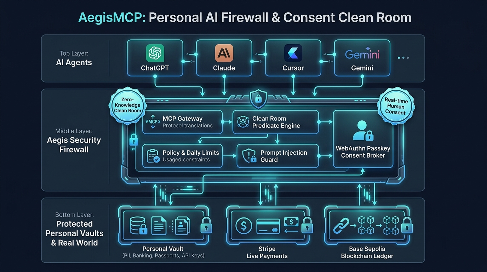

# AegisMCP: Architecture & Gated Approvals Slide Deck
*Track 2: Personal Agents & Data Privacy Hackathon Submission*

---

## Slide 1: AegisMCP Mission & The Privacy Dilemma

### Core Mission
Enable personal autonomous agents (ChatGPT, Cursor Agent, Claude) to order items, book flights, audit financials, and manage cloud credentials **with zero raw PII or financial credential leakage in LLM context**.

```
Traditional Agent Flow:
[User] ──(Prompts)──> [Agent LLM] ──(Raw Card, SSN, Address)──> [Merchant / API]
                         ⚠️ CRITICAL PRIVACY LEAK:
                         Raw credentials stored in LLM context,
                         vendor logs, training datasets & transcripts.
```

```
AegisMCP Protected Flow:
[User] ──(Prompts)──> [Agent LLM] ──(Tokenized / Clean-Room)──> [AegisMCP Gateway]
                                                                        │
                                                         Out-of-band TLS│ (Zero LLM Exposure)
                                                                        ▼
                                                             [Real World / Stripe]
```

---

## Slide 2: End-to-End System Architecture



### Core Architectural Flow:
1. **AI Agent Interaction**: Cursor Agent or ChatGPT sends an MCP JSON-RPC tool call over the persistent Cloudflare tunnel (`/mcp`).
2. **Policy & Risk Engine**: Evaluates the action, assigns risk levels (LOW, MEDIUM, HIGH, CRITICAL), and checks user spending limits.
3. **Clean-Room & Vault Isolation**:
   - `aegis-cleanroom`: Differential privacy computation for bank balances ($500 bucket quantization).
   - `aegis-vault`: Cryptographic HMAC surrogate tokens (`aegis_ship_...`, `aegis_pm_...`).
4. **Isolated Secrets Broker (`aegis-broker`)**:
   - Runs in isolated process space on port 8788.
   - Holds encrypted platform secrets and communicates out-of-band with real-world providers (e.g. Stripe live test charges).
5. **Real-time Maud Dashboard (`/u/maya`)**:
   - Renders live diff cards, countdown timers, and approval controls with `localStorage` persistence.

---

## Slide 3: The Human-in-the-Loop Consent Card

When an agent triggers a sensitive action, Aegis halts execution and presents an interactive diff card on the dashboard:

```
┌────────────────────────────────────────────────────────────────────────┐
│  🟡 [WAITING] Payment requires approval                                │
│                                                                        │
│  $45.00 to Apex Electronics                                            │
│  Agent: cursor-agent (Maya Personal Delegate)                          │
│  Purpose: Purchase 4-Port USB-C Hub                                    │
│  Auto-deny in: 52s                                                     │
│                                                                        │
│  [Remember this decision: Don't remember ▼]                            │
│                                                                        │
│  ┌───────────────────────┐ ┌──────────────────────┐ ┌────────────────┐ │
│  │ 1. Approve CLEAN ROOM │ │ 2. Approve REDACTED  │ │ 3. Allow RAW   │ │
│  │      (Tokenized)      │ │       (Masked)       │ │  (Plaintext)   │ │
│  └───────────────────────┘ └──────────────────────┘ └────────────────┘ │
└────────────────────────────────────────────────────────────────────────┘
```

> **Safety Lock**: For regulated identity attributes (SSN, Passport Number, Full Credit Card PAN), the **Allow RAW** button is hard-disabled with a safety lock tooltip.

---

## Slide 4: Button 1 — Approve CLEAN ROOM (Tokenized)
### 🛡️ Recommended Autonomous Mode: Maximum Privacy & Zero Leakage

#### What it does:
- Intercepts the request and issues single-use surrogate tokens for the physical address and payment method.
- Dispatches the real transaction **out-of-band** directly to the merchant (Stripe / Airline) via `aegis-broker`.
- Returns opaque surrogate references back to the agent context.

#### Example Output Sent to Agent:
```json
{
  "status": "APPROVED_TOKENIZED",
  "order_id": "aegis_ord_8f19c2e04",
  "shipping": {
    "recipient": "Maya Lin",
    "delivery_token": "aegis_ship_d37a892b10ef",
    "carrier_routing": "USPS_ZONE_4"
  },
  "payment": {
    "surrogate_token": "aegis_pm_7f8a9b2c3d4e",
    "live_stripe_charge": "pi_3UTVCdAM6XW2dK7l03VpX1rK",
    "amount_billed_usd": 45.00
  },
  "privacy_guarantee": {
    "raw_pii_exposed_to_model": false,
    "mutual_information_leakage": "0 bits"
  }
}
```

---

## Slide 5: Button 2 — Approve REDACTED (Masked)
### 🔍 Partial Verification Mode: Display Redaction with Asterisks

#### What it does:
- Obfuscates sensitive fields while preserving contextual shape (e.g. last 4 digits of card, city/state of shipping address).
- Real billing and dispatch still executed via backend proxy.
- Ideal when the agent must show a human-readable confirmation summary to the user in chat.

#### Example Output Sent to Agent:
```json
{
  "status": "APPROVED_REDACTED",
  "order_id": "aegis_ord_8f19c2e04",
  "shipping": {
    "recipient": "M*** L**",
    "street": "********************",
    "city": "San Francisco",
    "state": "CA",
    "postal_code": "941**"
  },
  "payment": {
    "card_brand": "Visa",
    "card_last4": "4242",
    "card_number": "**** **** **** 4242",
    "live_stripe_charge": "pi_3UTVCdAM6XW2dK7l03VpX1rK",
    "amount_billed_usd": 45.00
  },
  "privacy_guarantee": {
    "raw_pii_exposed_to_model": false,
    "sanitization_applied": "PII_REGEX_REDACTION"
  }
}
```

---

## Slide 6: Button 3 — Allow RAW (Plaintext Override)
### ⚠️ Explicit Developer / Direct Access Mode

#### What it does:
- Bypasses tokenization and releases the exact raw data into the LLM context.
- **Strict Guardrails**: Hard-coded software barrier automatically rejects RAW release for regulated government identifiers (SSN, Passport).
- Use case: Local testing, developer tools, or specific non-regulated fields where model code generation requires plaintext values.

#### Example Output Sent to Agent:
```json
{
  "status": "APPROVED_RAW_OVERRIDE",
  "order_id": "aegis_ord_8f19c2e04",
  "shipping": {
    "recipient": "Maya Lin",
    "street_address": "452 Tehama St, Apt 3B",
    "city": "San Francisco",
    "state": "CA",
    "postal_code": "94103"
  },
  "payment": {
    "cardholder": "Maya Lin",
    "card_number": "4242424242424242",
    "exp_month": 12,
    "exp_year": 2028,
    "cvv": "921",
    "amount_billed_usd": 45.00
  },
  "privacy_warning": "CRITICAL: Raw sensitive data injected into LLM context window."
}
```

---

## Slide 7: Side-by-Side Comparison Matrix

| Field | 1. Approve (Tokenized) | 2. Approve (Masked) | 3. Approve (Raw) |
| :--- | :--- | :--- | :--- |
| **Address Sent to LLM** | `aegis_ship_d37a892b10ef` | `San Francisco, CA 941**` | `452 Tehama St, Apt 3B` |
| **Payment Sent to LLM** | `aegis_pm_7f8a9b2c3d4e` | `**** **** **** 4242` | `4242424242424242` |
| **Passport Sent to LLM**| `aegis_pass_shielded` | `USA ••••••710` | 🚫 **BLOCKED (Regulated)** |
| **Stripe Execution** | Out-of-band broker proxy | Out-of-band broker proxy | Model direct / broker |
| **Mutual Information $I(X; Y)$** | **0 bits** | Leakage bounded | Complete data exposure |
| **Context Safe for Fine-Tuning** | **YES (100% Safe)** | Moderate (Partial leak) | **NO (High Risk)** |

---

## Slide 8: Real Agent Prompts & Live Demos

### Scenario 1: Autonomous E-Commerce Purchase
- **User Prompt**: *"Find a reliable USB-C Hub under $50 and order it for me via Aegis."*
- **Action**: Aegis holds tool call -> Maya clicks `Approve CLEAN ROOM` on dashboard -> Live Stripe charge `pi_3UTVCdAM6XW2dK7l03VpX1rK` -> Agent receives `aegis_ship_...` and confirms order without ever touching Maya's home address or payment credentials.

### Scenario 2: Differential Privacy Financial Check
- **User Prompt**: *"Can I afford to purchase a $45 desk accessory?"*
- **Action**: Aegis clean-room executes differential privacy coarse bucketing ($500 increment) -> returns `{ "can_afford": true, "requested_amount": 45.0, "checked_against": 500.0 }` without leaking Maya's bank balance.

### Scenario 3: Shielded Airline Booking
- **User Prompt**: *"Book United flight UA 1542 from SFO to JFK on Nov 5th for Maya Lin."*
- **Action**: Aegis contacts carrier API over TLS, injecting passport and DOB directly from encrypted vault -> Agent receives confirmed ticket reference `aegis_tkt_ua_94821`.
